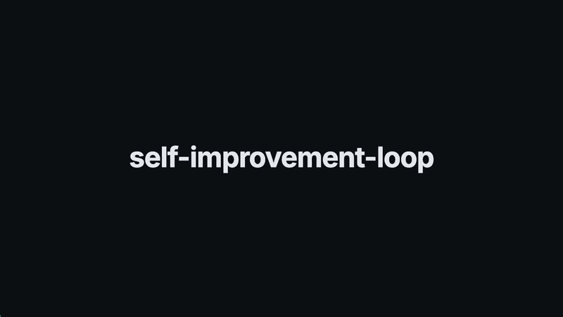

# self-improvement-loop

**Turn recurring Claude Code mistakes into reusable skills, hooks, rules and agents.**

Stop explaining the same correction from scratch. This plugin reviews your
coding sessions in the background, finds recurring lessons, and drafts changes
for you to review. Keep what helps. Reject what doesn't.

[](https://github.com/kolezka/self-improvement-loop/actions/workflows/ci.yml)
[](https://github.com/kolezka/self-improvement-loop/releases)
[](LICENSE)



[Watch as MP4](docs/media/demo.mp4) · [Install guide](docs/INSTALL.md) · [Report a bug](https://github.com/kolezka/self-improvement-loop/issues)

## Get started

You need [Bun](https://bun.sh) 1.4.2 or newer, Git, and a working Claude Code CLI.

```sh
claude plugin marketplace add kolezka/marketplace
claude plugin install self-improvement-loop@kolezka
```

Start a new Claude Code session, then run:

```text
/self-improvement-loop:loop
```

On a fresh install, this creates the config, a local `learned/` repository, and
`~/.local/bin/sil`. The default model provider is your `claude` CLI. Background
reviews make model calls and use your provider's quota or billing.

Open the web review console, or use the [native Claude Code panel](#claude-code-panel):

```text
/self-improvement-loop:loop web
```

Keep coding. When proposals are ready, review their diffs in the console.
To run the worker and console as background services on macOS or Linux:

```sh
sil schedule install --web
```

Make sure `~/.local/bin` is on your `PATH`. For other model endpoints and
troubleshooting, see the [install guide](docs/INSTALL.md). To install without a
plugin, follow [standalone installation](docs/INSTALL.md#standalone-install-from-a-checkout).

## Claude Code panel

Keep the loop beside your chat with the native **Claude Code Mods** panel.
Browse worker status, proposal diffs, artifacts and activity without opening a
browser. Capture and edit lessons, rate artifacts, or use action buttons to
queue the loop's commands in your session.

With the plugin installed and a Claude Code build that supports Mods, start it
with function hooks enabled:

```sh
CLAUDE_CODE_ENABLE_FUNCTION_HOOKS=1 claude
```

Then open the panel inside the session:

```text
/sil
```

Use `/sil capture` to start a lesson from selected chat text. Proposal acceptance,
rejection and revision still use the web console or CLI. The panel requires the
plugin; standalone installs use the web console or CLI instead.

See [panel setup and requirements](docs/INSTALL.md#native-console-sil).

## How it works

1. **Observe.** Hooks record session events without calling a model.
2. **Reflect.** A background worker reads session transcripts and extracts lessons.
3. **Draft.** Recurring patterns become proposed skills, hooks, rules or agents on Git branches.
4. **Review.** You inspect the diff and accept or reject it. Accepted artifacts can guide future sessions.
5. **Evaluate.** Usage and feedback help identify what to refine or retire.

For example, repeated claims of "tests passed" without a test run could become a
rule to run the relevant checks and report their results. This is an example of
the workflow, not a guarantee that an agent will stop making that mistake.

## Use it while you work

These commands are namespaced so they don't collide with commands from other plugins:

| Command | Use it to |
| --- | --- |
| `/self-improvement-loop:loop` | Check status; add `web` for the console or `run` for a worker pass. |
| `/self-improvement-loop:reflect` | Queue the current session for reflection. |
| `/self-improvement-loop:learn` | Turn a mistake you just caught into a proposed rule, skill, agent or nudge. |
| `/self-improvement-loop:toolify` | Turn the last working answer into a reusable skill. |
| `/self-improvement-loop:feedback skill:<name> good` | Rate an artifact; use `bad` for a misfire. |

For terminal reviews, start with `sil review list` and `sil review --help`.

## Your changes, your control

- **Review by default.** Proposals are staged on branches. Acceptance is tied to
  the exact diff you reviewed. Local auto-merge is a separate, opt-in setting.
- **Local storage, your model provider.** Reflections and feedback stay on disk.
  Transcript-derived content is sent to the model endpoint you configure.
  Local storage does not mean offline inference.
- **Separate projects.** Work and personal projects can use separate "worlds",
  each with its own lessons, target repository and model policy.
- **No automatic publishing.** Pushing or opening a PR requires human acceptance
  and an explicit per-world setting.

## Other agents

**Codex** can read lessons, review proposals and record feedback after
`sil codex install`. Its sessions do not feed the loop.

**OpenClaw** can feed sessions into the loop and receive lessons through
`AGENTS.md`. See the [OpenClaw guide](docs/OPENCLAW.md).

## Documentation

- [Install](docs/INSTALL.md): setup, model providers, scheduling and other hosts.
- [Operations](docs/OPERATIONS.md): reviews, configuration, worlds and troubleshooting.
- [Architecture](docs/ARCHITECTURE.md): how the loop works under the hood.
- [CLI reference and advanced topics](docs/LEGACY-README.md): archived README; use `sil <command> --help` for current flags.
- [Development and releases](docs/RELEASE.md): build and release process.

If the loop misses a repeated mistake, [open an issue](https://github.com/kolezka/self-improvement-loop/issues)
with a minimal, redacted example. Contributions are welcome.

[MIT license](LICENSE).
